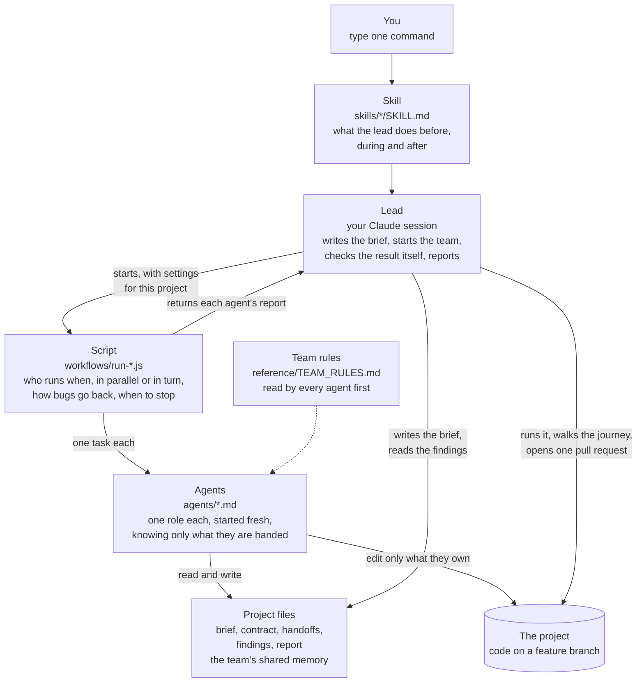
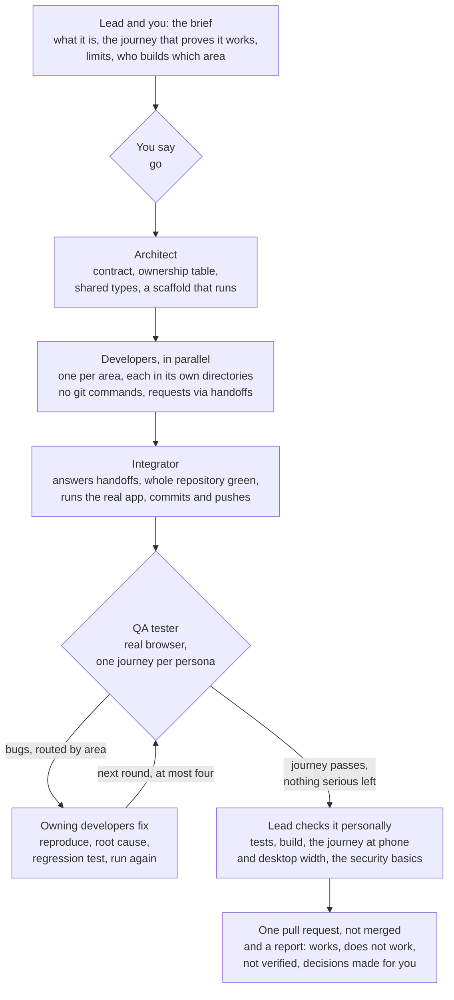
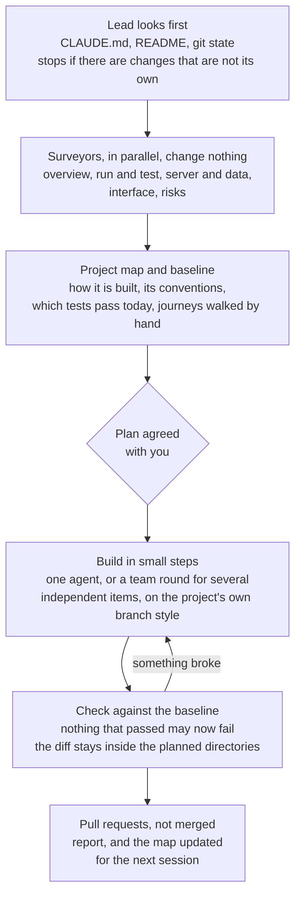
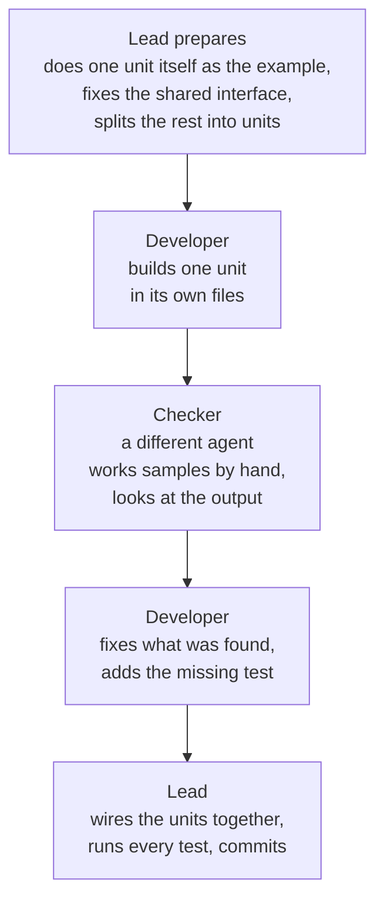
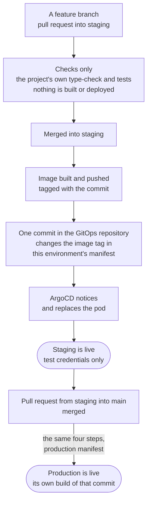

# acc-team

A reusable team of coding agents for Claude Code, with the method and the scripts that
make them work together.

It was taken from a real build (eliit tutor: a web application built unattended, then
extended, given payments and deployed to staging and production) and made generic, so the
same team can start a new project or pick up one that already exists.

Nothing in here is specific to one application. What is specific to a project (its stack,
its commands, its rules) stays in that project's own `CLAUDE.md`, `docs/BRIEF.md` and
`docs/PROJECT_MAP.md`.

- [Install](#install)
- [What you can ask for](#what-you-can-ask-for)
- [The team](#the-team)
- [Architecture](#architecture)
- [How it works](#how-it-works)
- [What the team writes into your project](#what-the-team-writes-into-your-project)
- [The rules, in short](#the-rules-in-short)
- [Changing it](#changing-it)
- [What has and has not been tested](#what-has-and-has-not-been-tested)

## Install

You need Claude Code with dynamic workflows available (the four commands start several
agents through the Workflow tool; on some plans it is switched on in `/config`), and Node
22 or newer for the two helper scripts.

### From GitHub

The repository is private, so the machine must already be able to read it with git (for
example after `gh auth login`, or with an SSH key). Claude Code uses those credentials and
does not ask for any.

```bash
claude plugin marketplace add gabrield2acc/acc-team-dev
```

```bash
claude plugin install acc-team@acc
```

Then start a new session. The plugin is installed for your user, so it is there in every
project. To install it for one project only and share it with whoever opens that project,
add `--scope project` to the second command.

Inside a session the same two steps are `/plugin marketplace add gabrield2acc/acc-team-dev`
and `/plugin install acc-team@acc`.

### From a local copy

```bash
git clone https://github.com/gabrield2acc/acc-team-dev.git
```

```bash
claude plugin marketplace add ./acc-team-dev
```

```bash
claude plugin install acc-team@acc
```

To try it for one session without installing anything:

```bash
claude --plugin-dir ./acc-team-dev
```

### Check that it loaded

In a new session, type `/acc-team`. The four commands below should be offered, and the nine
agents appear as `acc-team:architect`, `acc-team:qa-tester` and so on.

```bash
claude plugin list
```

### Update

After the repository changes (the `version` in `.claude-plugin/plugin.json` goes up with
each change):

```bash
claude plugin marketplace update acc
```

```bash
claude plugin update acc-team@acc
```

Then start a new session.

### Remove

```bash
claude plugin uninstall acc-team@acc
```

## What you can ask for

| Command | What happens |
|---|---|
| `/acc-team:new-app <what to build>` | You and the lead settle a brief. Then an architect writes the contract, developers build their areas in parallel, an integrator joins them up, and QA tests in a real browser and sends bugs back to the owning developer until the journey passes. You get a branch, one pull request and a written report. |
| `/acc-team:continue-app <what you want done>` | For a project that already exists and runs. The team first surveys it and changes nothing, writes a project map and a baseline of what works, agrees a plan with you, then builds in small steps that follow the project's own conventions and checks that nothing in the baseline broke. |
| `/acc-team:bulk-work <what to produce>` | For many similar pieces (content, data, generators, repeated modules). Each unit is built by one agent, checked by a different one who works samples by hand, and fixed. |
| `/acc-team:deploy-pipeline` | A staging and production pipeline: merge to `staging` deploys staging, merge to the default branch deploys production. Generates the GitHub Actions workflow, the manifests for both environments and the deploy guide from one config, and opens pull requests without merging. |

These four run only when you type them. They start many agents and cost accordingly; each
tells you roughly how many before it starts and waits for your yes.

The plugin also lists four entries beginning `run-` (`/acc-team:run-work-round` and so
on). Those are the scripts the commands start, with the settings the lead prepares; there
is no need to call them yourself.

## The team

| Agent | Job | May change |
|---|---|---|
| `architect` | Goes first on a new build: the contract, the ownership table, a scaffold that runs. | everything, once, before anyone else starts |
| `backend-dev` | Server side of one area: routes, data, integrations, tests. | only the directories it owns |
| `frontend-dev` | Screens of one area, against the contract and the design tokens, looked at in a real browser. | only the directories it owns |
| `developer` | Any other bounded area: a library, a data set, a tool, content. | only the directories it owns |
| `integrator` | Resolves handoffs, makes the whole repository green, runs the real app, commits and pushes the feature branch. | anything |
| `qa-tester` | Tests like a user in a real browser, has a veto, routes bugs to their owners. | only the end-to-end tests and the findings file |
| `checker` | Independently checks bulk work by working samples by hand. | nothing |
| `surveyor` | Reads an existing project and reports how it is built. | nothing |
| `release-engineer` | Image, workflow, environments, deploy guide. Opens pull requests and stops. | pipeline files; never a cluster or a secret |

Each can also be used on its own, for example "use the acc-team surveyor on the billing
code" or "have the acc-team qa-tester test the sign-up flow".

## Architecture

There are four kinds of piece. A **skill** is what you type: it tells the lead (your own
Claude session) what to do before, during and after. A **script** runs the team in a fixed
order, so the order does not depend on a model remembering it. An **agent** is one role.
The **project files** are how agents who never talk to each other stay in step.



| Piece | Where | Why it is separate |
|---|---|---|
| Skills | `skills/` | The lead's part needs judgement and a conversation with you: the brief, the plan, the final check. That cannot be scripted. |
| Scripts | `workflows/` | The team's part needs a fixed order: architect before developers, QA after integration, at most four rounds. A script guarantees it; a prompt only suggests it. |
| Agents | `agents/` | One file per role, used by the scripts and usable on their own. Changing how QA behaves is one edit in one place. |
| Team rules | `reference/TEAM_RULES.md` | The rules that apply to every role (ownership, git, secrets, what "done" means), written once. |
| Templates | `templates/` | The shape of the files the team shares, so every project's brief and report read the same way. |
| Pipeline generator | `scripts/render-pipeline.mjs` | Deploy files are produced by code from one config rather than typed by an agent, so they come out the same every time. |

Three ideas hold it together:

1. **A written contract, then separate areas.** Agents do not talk to each other. They all
   read one contract and each owns directories nobody else touches. A request to another
   area goes into a handoffs file.
2. **Different agents build and judge.** The developer who wrote something is never the one
   who passes it: QA tests the app, a checker samples bulk work, and the lead walks the
   journey personally before reporting.
3. **Nothing irreversible without you.** The team works on a feature branch, opens pull
   requests and stops. It never merges, never touches a cluster or a secret, never spends
   real money.

## How it works

### A new application: `/acc-team:new-app`



1. **Brief.** The lead asks you once for what it cannot decide, then writes
   `docs/BRIEF.md`: what is being made, the definition of done as a journey someone can
   walk, the limits, and a table of areas with directories that do not overlap.
2. **Architect.** One agent writes `docs/ARCHITECTURE.md`, the shared types and a scaffold
   in which every command already works. Developers start only when it has finished.
3. **Build.** One developer per area, at the same time, in the same checkout. They may not
   run git commands or edit each other's directories.
4. **Integrate.** One agent resolves the handoffs, makes install, type-check, tests and
   build pass everywhere, runs the real application, and commits.
5. **QA and fix.** The tester plays each persona in a real browser and returns structured
   bugs, each routed to the area that owns the fix. The owners fix them and QA tests again.
   It stops when the journey passes with nothing serious left, or after four rounds.
6. **The lead's own check, then the report.** What agents report is not treated as proof.

### An existing application: `/acc-team:continue-app`

On a project that already runs, the first risk is breaking what works. So nothing is
changed until the team has learned the project and you have agreed the plan.



The project map (`docs/PROJECT_MAP.md`) is what makes the second visit cheaper than the
first: the next session reads it instead of surveying again.

### Many similar pieces: `/acc-team:bulk-work`

Each unit goes through its own three steps, and units do not wait for each other.



Passing tests show that an author's code agrees with itself. The checker is there because
that is not the same as being right.

### Staging and production: `/acc-team:deploy-pipeline`



- Rolling back is reverting that one commit in the GitOps repository.
- Secrets are never in a repository: the manifest names a secret and you create it.
- An application that keeps data on disk runs as one replica with a volume, replaced
  rather than rolled.

The files are generated from one config:

```bash
node scripts/render-pipeline.mjs --config pipeline.config.json --out ./pipeline-out
```

The config is described in [`templates/deploy/README.md`](templates/deploy/README.md). The
generator assumes GitHub Actions, Docker Hub, ArgoCD, cert-manager and Traefik; for
anything else, generate and adapt.

## What the team writes into your project

| File | Written by | What it is for |
|---|---|---|
| `docs/BRIEF.md` | the lead, with you | What is being made, the definition of done, the limits, who builds what. |
| `docs/ARCHITECTURE.md` | the architect | The contract everyone builds against, with the ownership table. |
| `docs/PROJECT_MAP.md` | the lead, from the survey | How an existing project is built, and the baseline of what works. |
| `docs/HANDOFFS.md` | developers | Requests from one area to another, each answered done or declined. |
| `docs/QA_FINDINGS.md` | the QA tester | Every round's bugs, with steps and evidence. |
| the end-to-end tests | the QA tester | The definition-of-done journey as tests that stay. |
| the report | the lead | What works, what does not, what nobody verified, decisions made for you. |

## The rules, in short

The full text is [`reference/TEAM_RULES.md`](reference/TEAM_RULES.md); every agent reads
it first.

- One written contract first; then each developer owns directories nobody else touches.
- Requests between areas go in a handoffs file, not into each other's code.
- Developers sharing a checkout do not touch git; one integrator commits.
- QA writes no product code and has a veto. A bug is fixed only when it was reproduced,
  given a regression test, and seen to pass.
- The author of bulk work is never its only checker.
- The lead walks the journey personally before reporting, and the report says plainly what
  nobody verified.
- Secrets are never printed; staging never holds live credentials; nobody merges.

## Changing it

```
.claude-plugin/     plugin.json (name, version) and marketplace.json
agents/             the nine roles, one file each
skills/             the four commands
workflows/          the scripts that run the team
  run-new-app.js          architect, then run-work-round
  run-work-round.js       build in parallel, integrate, QA and fix rounds
  run-survey.js           read an existing project in parallel, change nothing
  run-build-check-fix.js  per unit: build, independent check, fix
reference/          TEAM_RULES.md
templates/          BRIEF, ARCHITECTURE, HANDOFFS, PROJECT_MAP, REPORT, and deploy/
scripts/
  render-pipeline.mjs     writes a project's pipeline files from one config
  dry-run.mjs             runs a script with pretend agents, to test an edit
```

- **A role behaves badly**: edit its file in `agents/`. The scripts use the same files.
- **The order of work should differ**: edit the script in `workflows/`, then test its flow
  without calling any model. The pretend QA finds one bug in round one, so the fix path
  runs too:

  ```bash
  node scripts/dry-run.mjs workflows/run-work-round.js
  ```

- **The pipeline should differ**: edit `scripts/render-pipeline.mjs`.
- **Check the plugin is well formed**:

  ```bash
  claude plugin validate .
  ```

- **Release the change**: raise `version` in `.claude-plugin/plugin.json`, commit and
  push, then update each machine as under [Update](#update).

A script and a skill must not share a name: both become `/acc-team:<name>`. That is why
the scripts all begin with `run-`.

## What has and has not been tested

- **Loads in Claude Code.** After installing, the nine agents and the four scripts were
  seen in a session, and both manifests pass `claude plugin validate`. The four commands
  are hidden from the model on purpose (only you can start them), so they were not seen
  the same way: type `/acc-team` to confirm they are offered.
- **The pipeline generator was checked against a pipeline that is deployed.** Given that
  project's config it reproduces both environments' manifests exactly, and the workflow
  with one job name different.
- **The team scripts have not yet run a real build in this generic form.** The roles, the
  rules and the order of work come from runs that worked on a real project, and the
  scripts' flow was checked with pretend agents (`scripts/dry-run.mjs`). Expect to adjust
  wording in the roles after the first real run on a second project.
